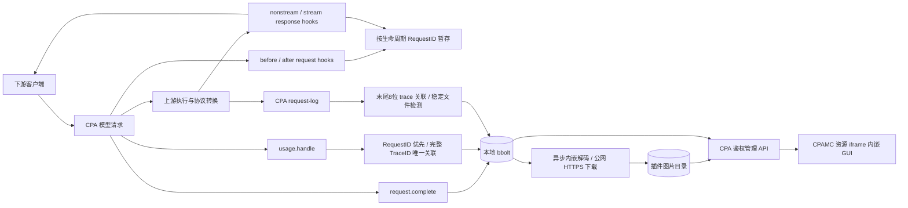

# 设计与数据边界

目标是可检查、可回放的请求档案：任何“原文”“耗时”“完整”的标签，都对应实际采集来源。

## 请求标识与生命周期

- lifecycle RequestID 作为条目 ID，完整 TraceID 保留以关联入口请求和多次上游尝试。
- before-auth 抓取当时的正文；响应 hook 的 OriginalRequest 存在时采用宿主原始请求副本。after-auth 的正文另存，绝不假定它是执行器翻译后的真正上游请求。
- header-init stream 事件用来缓存原请求与头部，不把它视为首分片；payload chunk 按顺序拼接。结束、失败、拒绝和取消以 terminal callback 为准。
- usage 回调可以先于或后于 completion，且 UsageReporter RequestID 可能不同。使用完整 TraceID 唯一匹配；同 trace 下多个同模型执行时不猜测归属。
- usage_attempts 按 reporter ID 去重，token 聚合包括重试尝试。缓存读取比例：OpenAI / Gemini 为 cache-read / input；原生 Claude 为 cache-read / (uncached input + cache read + cache creation)。原始计数同时保留。总耗时取 lifecycle 开始/结束，TTFT 取宿主 usage 数据，首分片耗时单独显示。
- 记录显示为“已结束”不等于“响应采集完整”。中断保留已有正文，超限保留部分并附提示。

## 最终结果与上游来源

响应 hook 的分片只在内存中累计，终结时汇总为最终 JSON；不保存 SSE 中间事件。Responses 使用最终 response 快照，Chat / Claude / Gemini 的增量按文本、可见思考、工具调用和原图组装。不能解析或截断时显示不完整状态，不把残缺内容称为完整结果。

CPA 日志按 trace 关联，等大小稳定与终结 RESPONSE 后，仅选最后一次 API RESPONSE 的完整最终结果，以及同索引的 API REQUEST 正文。此前失败尝试的正文、事件流、时间戳 / 头部包装不导入数据库；usage_attempts 继续保存重试消耗元数据。补全有容量和 30 秒等待限制。

最终快照不是原始 TLS / HTTP 抓包。原请求仍完整保存，服务端 previous_response_id 中未发送的历史和未返回的工具结果不能凭空恢复。

## GUI 与多模态

采用无构建依赖的 HTML/CSS/JS，随 Go 动态库 embed，资源路径按 CPA/CPAMC 官方约定注册。

对话解析不执行记录中的 HTML / JS，不自动执行工具调用，不自动发送对话。文本用 DOM textContent 展示。工具保留调用 ID，已有对应结果才展示结果。Responses 最终完整快照优先于增量事件，避免重复拼接。

同源 CPAMC 记住登录时，读取其 `cli-proxy-auth`（兼容旧键与已知存储格式）中的 API base 和凭据；仅在来源相同、无 URL 用户信息时复用，并向 CPA 发起鉴权请求。插件不写入浏览器持久化凭据，不因为处于 iframe 就省略鉴权。没有可读凭据时手动登录，后台采集不受影响。CPAMC 清除凭据时，自动登录的视图释放图片 / 清空条目。

CPAMC 的 key 备注是本地浏览器数据，指纹为 SHA-256(JSON.stringify(["api-key-name", apiBase, apiKey]))。连接后按当前 CPA key 列表在浏览器匹配，再同步插件的 SHA-256(apiKey) / 备注快照；只传指纹与名称，持久化到独立自动别名 bucket。原子替换自动快照，手动别名优先，不回写 CPAMC。跨来源、无浏览器备注或认证插件主体 ID 不匹配时不能推测名称。

图片解析支持原始 data URL / base64 / URL。v0.2.0 将可识别的图片异步归档到插件目录：内嵌数据解码，公网 HTTPS URL 由 CPA 后台获取；原始正文不改写。归档扫描原请求、选取凭证后的请求、下游最终结果和最后一次上游请求 / 结果。相同来源在记录内去重，相同内容跨记录共用以 SHA-256 命名的文件。

GUI 不给图片 DOM 设置原 URL，也不直接设置 data URL；仅调用同源、带管理 Bearer 的图片 API，转成 Blob URL 预览和下载。CSP 的 `img-src blob:` 提供额外约束，读取响应禁止缓存、嗅探和跨源嵌入。详情关闭后取消请求并释放 Blob URL。图片服务看到 CPA / 出口代理的 IP，收不到查看者的直接请求或管理密钥。插件沿用 CPA 的管理 API 和 TLS，不新增监听端口。

远程地址是未信任的请求数据：只允许 HTTPS 443，无 URL 用户凭证；每一跳重新校验所有 DNS 结果，拒绝私有 / 环回 / 链路本地 / 元数据 / 特殊网络，并固定连接到已验证公网 IP，TLS SNI 与证书仍使用源域名。出口代理仅支持 HTTP(S) CONNECT，CONNECT 目标同样为固定 IP，不放任代理重新解析源域名。保持证书验证，不转发原请求的 Cookie、Authorization、Referer。最多四次重定向、固定并发、总超时与大小限制；只接受识别出的位图格式，HTML / SVG 不进入图片响应。PNG / JPEG / GIF 另限制最大 8000 万像素。非图片附件及不能识别的字段仍可查看原文。

旧条目首次打开时补归档；失败显示具体原因并提供服务端重试，不回退浏览器直连。过期链接、需额外凭证、HTTP 或内网图床不能保证归档；原 URL 仍保留在原文。图片接口只接受已存在的记录 ID / 图片 ID，不能充当任意 URL 代理。

不会根据相似文本把不同请求自动串成一个会话。单次请求携带的 messages/input/contents 即该条目的历史；session_id 用于筛选相关请求。`previous_response_id` 的服务端历史、压缩掉的上下文或上游未暴露的思考不能从本记录中恢复。

## 持久化、容量与故障

- v0.3.0 正文按内容边界分块（4–64 KiB），每块用 SHA-256 标识并按需 gzip；跨字段和记录共用，引用计数按每条记录的唯一块集合维护。独立元数据行保存正文清单，解码验证长度、gzip 与 SHA-256；仅使用新存储格式；旧数据库被明确拒绝，不实现迁移。
- bbolt 事务原子保存正文清单、块与引用计数、摘要、时间索引、trace 索引与图片待处理标记；列表只读摘要，详情才读取正文。默认 `data/request-recorder.db` 相对 CPA 工作目录。
- 图片默认在数据库旁的 `<数据库名>-images/`，可配置 `images_dir`。独立 bbolt bucket 存图片索引，下载状态更新不重写巨大正文或覆盖并发的 usage / 日志补全。
- 图片工作标记持久化、内存队列有界；重启和队列溢出后续处理。图片写入使用受目录约束的 `os.Root`、随机临时文件、fsync 和 rename；读取校验摘要 / 大小 / MIME，不公开目录。目录应由插件独占。
- 图片有单体字节、总字节、文件数和每条记录数量配额；不驱逐被引用的图片。记录清理同时删除图片索引，每分钟扫描无引用文件，至少 5 分钟宽限后删除，不碰其他命名的文件。
- 迁移 / 停机备份应同时复制数据库和图片目录；CPA 原始请求日志仍在 CPA 的实际日志目录，插件运行错误进入 CPA 进程日志。以上文件不加密，TLS 不加密磁盘。
- key 别名按指纹动态关联，因此修改别名会反映到历史记录。认证插件的 APIKey 字段可能是主体 ID，需按宿主实际暴露的标识绑定。
- 采集中正文受单体大小、总内存预算和并发数限制。达到上限可截断或跳过新采集，不更改客户端响应；status 暴露丢弃数。内存预算不包括 Go runtime、JSON 编解码、bbolt mmap 和后台日志导入，不能当作进程 RSS 上限。
- 采集中的正文暂存在内存，正常关闭时写 incomplete；进程崩溃/强杀前未终结的请求可能丢失。这一版不是逐分片 fsync 的审计系统。
- 记录已写入但待补全的日志任务会在进程重启时从数据库 pending 标记重新排队，再尝试补全 30 秒；队列上限 4096。
- 最大 30 分钟等待 terminal callback，超时保存 incomplete。存储失败会在 status 和宿主日志中报告。
- 保留期限/数量定期删除记录，不删除 CPA 源日志，不擦除磁盘旧页，按容量与空闲比例自动整理，复制一致快照并重放期间有界写入，短暂屏障下替换工作库。活动数据库上限默认 1 GiB，自动淘汰最旧记录；写入和整理间可短暂超限，临时文件另计。新格式库不能用旧插件读取。不能把此保留策略当作安全擦除。

## 目前的宿主限制

1. 只覆盖进入 request interceptor 的模型执行。入口鉴权失败、路由前错误不一定有 callback；不能承诺记录所有下游 HTTP 请求。
2. 不能从现有 hook 强行取得客户端 socket IP；只采用宿主元数据中的 client_ip / resolved_client_ip，不擅自信任 X-Forwarded-For。当前实际验证宿主未向插件暴露 IP，UI 显示未知。
3. Native WebSocket observer、二进制 multipart 上传和其他未列出的协议尚未实现。它们不能因普通 HTTP 测试通过就视为支持。
4. 后续插件 / 宿主在 response hook 后仍可修改数据。插件优先级只能控制观察位置，不能取代最外层 HTTP tee。若要保证“客户端实际收到的逐字节响应”，需要宿主新增最终输出 observer。
5. 已发布 GitHub Release，并提供可添加到 CPA 的自定义 registry；五个平台通过原生构建和官方安装器验证，Linux amd64 完成发布库的实际装载。官方商店上架、其他平台在真实 CPA 中装载、真实上游账号验证尚未完成。
